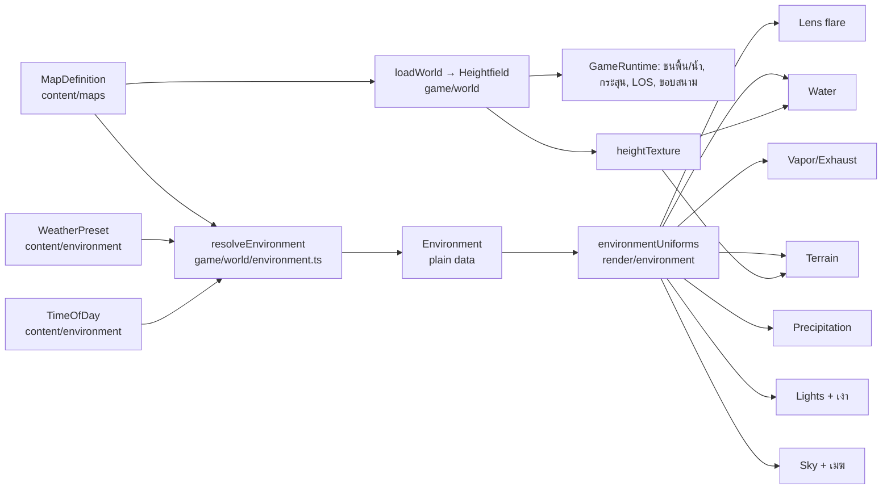

# 22 — Environment & Maps: แสงเงา, สภาพอากาศ และแผนที่หลายแบบ

[กลับ Master Plan](../../MASTER_PLAN.md) · Track E (E0–E9) · พึ่ง 01, 03, 07, 11, 12, 13, 14, 15, 17, 20, 21 · decision D18 ใน 19

เอกสารนี้เป็นเจ้าของ **ระบบสภาพแวดล้อมของโลก** สามเรื่อง: ระบบแสงเงา (พระอาทิตย์, lens flare แบบ ghost/halo, เงา), ระบบสภาพอากาศ และระบบแผนที่ที่มีหลายแบบ (terrain ปกติ, ทะเล, ภูเขา) กฎ collision, ขอบสนาม และ schema ของ map ฝั่ง gameplay ยังเป็นของ [14](14-world.md) เอกสารนี้บอกว่าจะสร้างไฟล์ไหน ทำหน้าที่อะไร และแก้โค้ดเดิมตรงไหน

สถานะ: **แผน (20 ต.ค. 2026)** ยังไม่มีโค้ด ค่าตัวเลขทั้งหมดเป็นค่าเริ่มต้นสำหรับทดลอง คำถามที่รอเจ้าของตัดสินอยู่ท้ายเอกสารและใน D18

## เป้าหมาย

1. **แสง:** เมื่อกล้องเงยมองพระอาทิตย์ จะเกิด lens flare แบบ ghost (วงสะท้อนในเลนส์เรียงตามแนวพระอาทิตย์) และ halo (วงแหวนแสง) ความแรงขึ้นกับมุมมอง การบัง และสภาพอากาศ เครื่องบินมีเงา และ terrain มีเงาจากภูเขาและเมฆ
2. **สภาพอากาศ:** preset เช่น ฟ้าโปร่ง, เมฆกระจาย, เมฆครึ้ม, หมอก, ฝน, พายุ เปลี่ยนท้องฟ้า เมฆ หมอก แสง ความชื้นของ vapor และฝน
3. **แผนที่:** หลาย map ที่มี terrain ปกติ (เนิน ไร่ ป่า แม่น้ำ), ทะเล (เกาะ หน้าผา น้ำ) และภูเขา (สันเขา หุบเขา หิมะ) บินชนพื้นและน้ำได้จริง
4. **ข้อบังคับ:** แสงเงาและสภาพอากาศต้องใช้ได้กับ **ทุก map** โดยคนสร้าง map ใหม่ไม่ต้องเขียนโค้ดแสงหรือสภาพอากาศเอง

ไม่อยู่ในขอบเขตนี้: กลางคืน (รอ D18), weather ที่เปลี่ยน flight forces (14 เลื่อนไว้; ดู E9), terrain destruction, world streaming, planar reflection ของน้ำ

## สภาพโค้ดตอนนี้

| เรื่อง | ที่อยู่ | ปัญหาเมื่อจะเพิ่มระบบ |
|---|---|---|
| ท้องฟ้า, ทิศพระอาทิตย์, หมอก | `src/render/range/TrainingRange.tsx` (`SUN_POSITION`, `HAZE`, `FOG_DENSITY`, zenith) | เป็นค่าคงที่ของ map เดียว แต่ทุก map ต้องใช้ |
| เมฆ | `src/render/range/shaders.ts` `cloudDeck(dir, 3000., 1500., .6)` | ค่าฝังใน GLSL; คืน 0 เมื่อกล้องสูงกว่าฐานเมฆ จึงไม่มียอดเมฆให้เห็นจากข้างบน |
| ทิศแสงของ vapor | `src/render/vapor/CondensationVolume.ts` `lightDirection.set(100, 600, 300)` | ซ้ำกับ `SUN_POSITION` โดยเขียนแยก |
| ความชื้นและอุณหภูมิ | `src/render/vapor/atmosphere.ts` `flatRangeAtmosphere` (26 °C, RH 82%) → `sampleAir(atmosphere, altitude)` | ค่าเดียวทุก map จนกว่าจะมี Environment (D19) |
| Render pipeline | `CondensationVolume.render()` วาด scene ลง MSAA HalfFloat target ที่มี `depthTexture` แล้ว composite ลงจอ | เป็นเจ้าของ pipeline โดยไม่ได้ตั้งใจ; ถ้าใส่ flare ลงไปจะบวม ส่วนดีคือ pass นี้รันทุก preset จึงมี `sceneDepth` ให้ flare ใช้เสมอ |
| Tone mapping | sky shader ทำ ACES เองและ clamp 0–1 | ไม่มีค่า HDR ของดวงอาทิตย์ จึงทำ flare จาก bloom threshold ไม่ได้ |
| พื้น | `Ground` ใน TrainingRange: plane 30 km ตามกล้อง + `rangeGround()` procedural | เรียบสนิท ไม่มีความสูง |
| ชนพื้น/ขอบสนาม | `src/game/flight/stepFlight.ts:148-151` (`y <= 3`, import `trainingMap`) | flight core ผูกกับ map เดียว |
| กระสุนชนพื้น | `src/game/combat/projectiles.ts` `GROUND_Y` → `castSegment` ใน `collision.ts` | รู้จักแค่พื้นราบ |
| เลือก map | `src/render/FlightScene.tsx` hardcode `mapId: 'flat-range'` และ `<TrainingRange />` | `settings.pveSetup.mapId` ไปไม่ถึง flight |
| Catalog | `src/content/maps/index.ts` รวม `trainingMap` กับ catalog ไว้ไฟล์เดียว | จะโตเร็วเมื่อมี terrain recipe |
| ความสูงใน HUD | `hudPainter.ts` แสดง MSL; `telemetry.ts` `lowAltitude` เช็ก `y < 100` | เหนือภูเขาต้องใช้ AGL |

**สรุปการประเมินโครงสร้าง:** การแบ่ง layer ตาม 01 (`content` = ข้อมูล, `game` = logic ล้วนรันใน Node, `render`/`features` = view) เหมาะและรองรับระบบใหม่ได้ ต้องแก้จุดผูกติดข้างบนก่อน (phase E0/E2) ไฟล์เดิมใน `src/render/` ระดับบนค่อนข้างปนกัน แต่ **ไม่ย้ายไฟล์เดิมเพื่อความเรียบร้อยอย่างเดียว** เพราะ diff จะใหญ่และอ่านยาก ระบบใหม่อยู่ใน folder ใหม่ ส่วนไฟล์เดิมย้ายเฉพาะส่วนที่ต้องแยกออกจริง

## หลักการ: Map กับ Environment แยกกัน

- **Map** ตอบว่า "ที่ไหน": terrain, ทะเล, props, bounds, ความสูงอ้างอิง และ climate ของพื้นที่
- **Environment** ตอบว่า "เมื่อไหร่และอย่างไร": เวลาของวันและ weather preset
- รวมกันจุดเดียวที่ `resolveEnvironment(map, weatherId, timeOfDayId)` ได้ `Environment` เป็น plain data ไม่มี three.js
- ทุก renderer อ่าน `Environment` ผ่าน uniform ชุดเดียว ไม่มี renderer ไหนเก็บค่าแสงหรือหมอกของตัวเอง



`Environment` อยู่ใน `game/world` ไม่ใช่ `render` เพราะภายหลังบอท, IR lock และ multiplayer server ต้องรู้ค่าเดียวกัน (visibility, ทิศพระอาทิตย์) และ match config ต้องเก็บ weather/เวลาไว้ข้าง `mapId`

## ทำให้แสงเงาและสภาพอากาศใช้ได้ทุก map

1. **ค่าของ weather อิงกับ map ไม่ใช่ค่าความสูงตายตัว** ฐานเมฆกำหนดเป็นระยะเหนือ `map.referenceHeightM` (เช่น ความสูงสันเขาเฉลี่ยของ Mountains) เมฆจึงไม่จมในภูเขาและไม่ลอยสูงเกินบน map ราบ ทัศนวิสัยแปลงเป็น fog density แล้วจำกัดไม่ให้บางเกิน `map.viewDistanceM` เพื่อไม่ให้เห็นขอบ far plane หรือขอบ terrain คลื่นทะเลใช้เฉพาะ map ที่มี `seaLevelM`
2. **Map ประกาศ climate ได้:** `allowedWeathers`, `defaultWeather`, `defaultTimeOfDay`, `humidityBias` (ชายฝั่งชื้นกว่า), `snowLineM` (ฝนกลายเป็นหิมะเหนือระดับนี้) ส่วน preset เป็นของกลางที่ทุก map ใช้ร่วม
3. **Uniform ชุดเดียวกับ GLSL chunk กลาง** material ของ terrain, water และ props สร้างจาก `MeshStandardMaterial` + `onBeforeCompile` (แบบเดียวกับ `Ground` ตอนนี้) แล้วเรียก `patchEnvironment(material)` เพื่อฉีด fog, cloud shadow และความเปียก ส่วน sun light, ambient และ shadow map ได้จาก three lights ที่สร้างจาก `Environment` โดยตรง map ใหม่จึงไม่ต้องเขียนโค้ดแสง
4. **Lens flare เป็น screen-space และอ่าน depth** จึงใช้ได้ทุก map เอง ภูเขา เครื่องบิน หรือเมฆที่บังพระอาทิตย์ทำให้ flare หรี่โดยไม่ต้องรู้ว่าเป็น map ไหน
5. **เงาใช้ได้ทุก heightfield:** terrain shadow bake ทำตอนโหลด map จาก heightfield ใดก็ได้; aircraft shadow ตามเครื่องผู้เล่น; cloud shadow ใช้ฟังก์ชันเมฆเดียวกับ sky
6. **ฝนและหิมะผูกกับกล้อง** วาดเฉพาะระหว่างผิวพื้นกับฐานเมฆ ไม่ขึ้นกับ map
7. **flat-range กลายเป็น map ปกติ** (heightfield ค่าศูนย์ + biome desert: ทะเลสาบแห้งแบบสนามทดสอบ Edwards/Nellis) เป็นตัวพิสูจน์ว่า pipeline เดียวใช้ได้ตั้งแต่ map แรก
8. **QA matrix:** test ทุก map × ทุก weather ที่อนุญาต × ทุกเวลา ว่า resolve ได้, ฐานเมฆอยู่เหนือยอดเขาตามกฎ, spawn ไม่จมพื้น และ fog ไม่บางเกิน view distance พร้อมสคริปต์ถ่ายภาพ matrix เพื่อตรวจด้วยตา และวัด performance กรณีหนักสุด (Mountains + Storm + High)

## ข้อมูล (data shapes)

```ts
// src/content/environment/weatherPresets.ts
export type WeatherId = 'clear' | 'scattered' | 'overcast' | 'fog' | 'rain' | 'storm'
export interface CloudLayerPreset {
  kind: 'cumulus' | 'stratus' | 'cirrus'
  baseAboveRefM: number   // เหนือ map.referenceHeightM
  thicknessM: number
  cover: number           // 0–1
  scaleM: number
}
export interface WeatherPreset {
  id: WeatherId
  clouds: CloudLayerPreset[]
  visibilityM: number     // แปลงเป็น fog density
  sunDimming: number      // 0 = แดดเต็ม, 1 = ไม่มีแสงตรง
  humidity: number        // 0–1 ส่งเข้า vapor
  precipitation: { kind: 'none' | 'rain'; rate: number }  // หิมะมาจาก snowLineM ของ map
  wind: { speedMps: number; headingDeg: number }          // visual อย่างเดียวจนกว่า E9
  lightning: boolean
}

// src/content/environment/timesOfDay.ts
export type TimeOfDayId = 'dawn' | 'noon' | 'dusk'
export interface TimeOfDay {
  id: TimeOfDayId
  sunElevationDeg: number; sunAzimuthDeg: number
  sunColor: string; zenith: string; horizon: string
  ambientSky: string; ambientGround: string
}

// src/content/maps/types.ts — รวม schema ของ 14 เข้ากับ catalog เดิม (id, name, info, status, pveModes)
export interface MapDefinition {
  id: string; name: LocalizedText; info: LocalizedText; status: MapStatus; pveModes: PveModeId[]
  biome: BiomeId                         // 'desert' | 'farmland' | 'coastal' | 'alpine'
  terrain: { kind: 'flat' } | { kind: 'procedural'; recipe: TerrainRecipeId; seed: number; sizeM: number; cellM: number }
  referenceHeightM: number
  seaLevelM: number | null               // null = ไม่มีทะเล
  viewDistanceM: number
  bounds: { radiusM: number; ceilingM: number }
  spawnPoints: SpawnPoint[]; teamSpawns: Record<'blue' | 'red', string[]>  // ตาม 14
  climate: { allowedWeathers: WeatherId[]; defaultWeather: WeatherId; defaultTimeOfDay: TimeOfDayId; humidityBias: number; snowLineM?: number }
  // controlPoints, flagBases, crownSpawns, flyoverPoints, campaignTargets ตาม 14
}

// src/game/world/environment.ts — ผลที่ resolve แล้ว ความสูงเป็น MSL
export interface Environment {
  sunDirection: Vec3; sunColor: Rgb; sunIntensity: number
  ambientSky: Rgb; ambientGround: Rgb; zenith: Rgb; horizon: Rgb
  fogDensity: number
  clouds: Array<{ kind: CloudLayerPreset['kind']; baseM: number; topM: number; cover: number; scaleM: number }>
  humidity: number
  temperatureC: number    // ผิวพื้น °C ส่งเข้า vapor คู่กับ humidity (D19)
  wind: Vec3
  precipitation: { kind: 'none' | 'rain' | 'snow'; rate: number }
  lightning: boolean
  seed: number
}
```

Session config (`src/content/schemas.ts`) เพิ่ม `environment: { weatherId, timeOfDayId }` และ `seed` ข้าง `mapId` ค่าคงที่ตลอด match multiplayer ภายหลังจึงส่งแค่ id กับ seed preset `clear` + `noon` ต้องให้ภาพและ vapor เหมือนสนามฝึกปัจจุบัน

## ระบบที่ 1: แสง — Lens flare (ghost + halo)

**วิธี:** post pass แบบ analytic หลัง vapor/exhaust composite และก่อน HUD canvas

- ไม่ใช้ bloom threshold เพราะ sky clamp 0–1 แล้ว
- ไม่ใช้ `Lensflare` ของ three addons เพราะมัน copy framebuffer เพื่อเช็กการบังเอง ซึ่งน่าจะชนกับ MSAA target ของ pipeline

**ขั้นตอนต่อเฟรม:**

1. **CPU (pure TS, `sunScreen.ts`):** project ทิศพระอาทิตย์ลงจอ คำนวณ `facing` จาก dot ของทิศกล้องกับทิศพระอาทิตย์ ถ้าพระอาทิตย์อยู่หลังกล้อง หรือพ้นขอบจอเกิน margin หรือต่ำกว่าขอบฟ้า ให้ข้าม pass ทั้งหมด
2. **Visibility pass (GPU, target 1×1):** sample `sceneDepth` ราว 16 จุดรอบตำแหน่งพระอาทิตย์ นับสัดส่วนที่ depth == 1 (ท้องฟ้า) เมฆ cumulus ในท้องฟ้าไม่เขียน depth จึงคูณด้วย luminance ของ `sceneColor` ที่จุดเดียวกัน smooth ราว 0.1 s ด้วยการ blend กับค่าเฟรมก่อน (ping-pong 1×1) เพื่อกันกระพริบตอนปีกผ่าน ไม่มี CPU readback
3. **Flare pass (fullscreen additive, 1 draw):**
   - glow รอบดวงอาทิตย์ + starburst 6 แฉกตามรูรับแสง
   - ghost 5–7 วงทรง hexagon บนเส้นจากพระอาทิตย์ผ่านกลางจอ (ตำแหน่ง k ประมาณ −0.4 ถึง 1.8 ของเส้น) ขนาดและสีต่างกัน มี chromatic offset RGB เล็กน้อย
   - halo: วงแหวนรอบดวงอาทิตย์ และวงแหวนกลางจอที่สว่างขึ้นเมื่อพระอาทิตย์เข้าใกล้กลางจอ
   - veiling glare: ยกความสว่างทั้งจอและลด contrast เล็กน้อยเมื่อมองตรงพระอาทิตย์
4. **ความแรง** = `facing × visibility × (1 − sunDimming) × hazeFactor × elevationFade` ค่าทั้งหมดมาจาก `Environment` เมฆครึ้มจึงทำให้ flare หายเอง

ตอนนี้พระอาทิตย์สูงราว 62° (`[100, 600, 300]`) ต้องเงยจริงถึงเห็น ตรงกับโจทย์ เวลา dawn/dusk ทำให้พระอาทิตย์ต่ำและเห็น flare บ่อยขึ้นมากระหว่างต่อสู้ ซึ่งกระทบการมองเห็นศัตรู (D18)

**Settings:** Graphics › Lens flare `off | low | high` (low = glow + halo, high = ghost + starburst + glare) เปิด reduced motion แล้วลดความแรงและปิด glare

## ระบบที่ 1b: เงา

| ชนิด | วิธี | ทำงานกับ map |
|---|---|---|
| Terrain shadow (ภูเขาบังแดด) | bake ตอนโหลด map: raymarch heightfield ไปทางพระอาทิตย์ ได้ sun-visibility texture ความละเอียดต่ำกว่า heightfield ทำได้เพราะพระอาทิตย์นิ่งตลอด match | ทุก heightfield; flat ได้ค่า 1 ทั้งหมด |
| Aircraft shadow | `DirectionalLight` shadow แบบ ortho frustum แคบ (~40 m) ตามเครื่องผู้เล่น ความลึกยาวตามทิศแสง เงาบนพื้นอยู่ตำแหน่งเดียวกันใน light space จึงตกพื้นได้ตอนบินต่ำโดยไม่ต้องขยาย frustum | ทุก map เพราะ terrain/water เป็น `MeshStandardMaterial` ที่ `receiveShadow` |
| Cloud shadow | ใน `patchEnvironment`: project ตำแหน่งผิวตามทิศแสงขึ้นไปที่ฐานเมฆ แล้วประเมิน cover ด้วยฟังก์ชันเดียวกับ sky | ทุกผิวที่ patch |

ไม่ทำ shadow map ครอบ 10 km เพราะแพงเกินและความละเอียดไม่พอ Canvas ของ flight ต้องเปิด `shadows` เมื่อ setting ไม่ใช่ off

**Settings:** Graphics › Shadows `off | low | high` (off = ไม่มี aircraft shadow; terrain bake ยังทำเพราะถูก; high = shadow map ใหญ่ขึ้นและ soft)

## ระบบที่ 2: แผนที่

### World core (sim)

- `Heightfield` เก็บ grid เป็น `Float32Array` มี `heightAt(x, z)` แบบ bilinear และ `normalAt(x, z)` ผิวที่ใช้ชนคือ `surfaceAt = max(terrain, seaLevel)` มี `isWater`
- **แหล่งข้อมูล (ข้อเสนอ):** seeded procedural recipe สร้าง grid ครั้งเดียวตอนโหลด ทั้ง sim และ render อ่าน array เดียวกัน ไม่ evaluate noise คนละที่จึงไม่เพี้ยนกัน noise ใช้ hash ที่เขียนเองด้วย `+ − × ÷` และ `Math.floor` เท่านั้น ไม่ใช้ `Math.random`/`Math.sin` เพื่อให้ browser กับ Node ได้ผลตรงกัน (Math.sin ไม่รับประกัน bit-identical) ทางเลือกคือ bake binary ด้วยสคริปต์ (ได้ erosion ที่สวยกว่า แต่ต้องเพิ่ม LFS ใน `.gitattributes`) — D18
- ขนาดตั้งต้น: พื้นที่เล่น ~10×10 km cell 10 m (~1M ค่า, 4 MB) บวกขอบนอกที่ cell หยาบ (~40 m) ถึง view distance ถ้าสร้างช้าเกินให้ย้ายไป Web Worker
- **ชนพื้น:** swept check ต่อ flight substep เทียบ `surfaceAt` กับจุดต่ำสุดของ hitbox (ปลายปีกตอน bank) แทน `y <= 3` บน flat-range ต้องให้ผลเหมือน `y <= 3` เดิมทุก tick เพื่อให้ flight goldens ไม่ขยับ ชนน้ำได้ `stopReason: 'water'`
- **กระสุน:** `castSegment` รับ ground query แทน `groundY` แล้ว march ตามขนาด cell (1,030 m/s ที่ 120 Hz ≈ 8.6 m ต่อ tick)
- **LOS:** `hasLineOfSight(from, to)` สำหรับบอท/IR ภายหลัง และ terrain occlusion ใน 17
- **ขอบสนาม:** ย้ายจาก `stepFlight` ไป `boundary.ts` แล้วทำ soft-bounds 8 s ตาม 14 ใน phase ที่ทำ match rules
- **AGL:** HUD เพิ่ม radar altitude และ PULL UP แบบ look-ahead ตามเวลาถึงพื้น; `lowAltitude` ใช้ AGL
- **Validation:** spawn ทุกจุดสูงกว่า `surfaceAt` + safe clearance, จุดยึด/ฐานธงอยู่ใน bounds และบินผ่านใต้เพดานได้

### Terrain renderer

- Geometry clipmap: วงตาราง LOD ซ้อนรอบกล้อง (วงในละเอียด วงนอกหยาบ) snap ตาม cell กัน swimming มี skirt กันรอยต่อ
- Vertex displacement จาก height texture (`DataTexture` สร้างจาก `Heightfield` ชุดเดียวกับ sim)
- Shading: splat ตาม slope, ความสูง และ biome (หญ้า, ป่า, หิน, หิมะ, ทราย, หน้าผา) detail จางตาม `fwidth` แบบ `rangeGround` เดิมเพื่อไม่ให้ไกล ๆ กระพริบ พื้นทะเลทรายของสนามฝึกย้ายมาเป็น albedo ของ biome `desert` ส่วน biome `farmland` ของ Countryside เริ่มจาก `rangeGround` แบบไร่เดิม (ดูใน git ก่อนเปลี่ยนเป็นทะเลทราย 2026-10-23) โทนพื้นของทุก biome ต้องไม่กลืนกับ HUD สีเขียว
- นอกเขตเล่น: terrain หยาบต่อไปถึง fog และใช้ภูเขาจาง ๆ ใน sky shader เดิมเป็นฉากหลัง

### น้ำ

- Plane ที่ `seaLevelM` ตามกล้องแบบ `Ground` เดิม
- Normal เลื่อน 2–3 octave, Fresnel สะท้อนสีท้องฟ้า (ใช้ GLSL ชุดเดียวกับ sky), sun glint, สีตามความลึกที่อ่านจาก height texture (ตื้นเป็นฟ้าเขียว ลึกเป็นน้ำเงินเข้ม), ฟองตามชายฝั่ง, ความแรงคลื่นตาม `wind` normal จางตามระยะกันกระพริบเมื่อบินสูง
- ไม่ทำ planar reflection; ละอองน้ำเมื่อบินต่ำเหนือน้ำเป็น polish ภายหลัง

### Maps ชุดแรก (หนึ่ง map ต่อแบบ)

| id | แบบ | ลักษณะ | climate (ข้อเสนอ) |
|---|---|---|---|
| `flat-range` | ราบ (มีอยู่) | สนามฝึกเดิม เป็น heightfield ศูนย์ | ทุก weather; default clear/noon |
| `countryside` (ใหม่) | terrain ปกติ | เนินลาด ไร่ ป่า แม่น้ำ | ทุก weather |
| `coastal` (มีใน catalog) | ทะเล | เกาะ หน้าผา อ่าว ทะเลเปิดด้านหนึ่ง | `humidityBias` สูง; มี fog |
| `mountains` (มีใน catalog) | ภูเขา | ridged noise สันเขาสูง หุบเขาให้บินต่ำ หิมะ | `snowLineM`; ฐานเมฆอิงสันเขา |

Campaign maps (`open-sea`, `frontier-valley`, `coastal-ridge`, `main-base-plateau`, `capital-airspace`) ใช้ recipe/biome เดียวกันโดยเปลี่ยน seed และพารามิเตอร์ ไม่ต้องสร้างระบบใหม่ `MapPreview` สร้าง shaded relief จาก heightfield อัตโนมัติ

## ระบบที่ 3: สภาพอากาศ

- **Sky:** เมฆอ่านจาก `Environment.clouds` (หลายชั้น) แทนค่าฝัง; overcast เป็นชั้น stratus ทึบที่ลดแสงตรงและ ambient; **ยอดเมฆเมื่ออยู่เหนือชั้นเมฆ** (ตอนนี้ไม่มี) cirrus ใช้ชั้นเดียวกัน
- **บินทะลุเมฆ:** เมื่อกล้องอยู่ในความหนาของชั้นเมฆ หมอกเพิ่มเป็น whiteout แบบ smooth พร้อม particle เมฆผ่านกล้อง
- **ความชื้น:** Environment ส่ง `VaporAtmosphere` (`temperatureC` ผิวพื้น + `humidity`) เข้า `flightVaporConditions(state, atmosphere)` แทน `flatRangeAtmosphere` preset clear ต้องให้ค่าเท่า `flatRangeAtmosphere` และ `vapor.test.ts` ต้องผ่าน (D19)
- **ฝน:** streak particles แบบ instanced ในกล่องรอบกล้อง wrap ด้วย modulo วางแนวตามความเร็วสัมพัทธ์ (ความเร็วฝน − ความเร็วเครื่อง) ที่ 200 m/s จะเห็นเป็นเส้นพุ่งเข้าหา วาดเฉพาะระหว่างผิวพื้นกับฐานเมฆ เหนือ `snowLineM` เปลี่ยนเป็นหิมะ ผิว terrain และ props เข้มและมันขึ้นเมื่อเปียก (ผ่าน `patchEnvironment`)
- **พายุ:** ฝนหนัก + ฟ้าแลบ (flash แสงในเมฆและ ambient สั้น ๆ) เสียงฟ้าร้องรอ AudioDirector ใน 12
- **ทางเลือก:** หยดน้ำบนเลนส์กล้องแบบ Ace Combat 7 (D18)
- **ผลต่อ gameplay:** E1–E8 เป็น visual อย่างเดียวตาม 14 ผลต่อบอท/IR lock/flight forces อยู่ใน E9 ที่ต้องรอเจ้าของตัดสิน ถ้าทำต้องบอกผู้เล่นใน UI

**Settings:** Graphics › Weather effects `low | high` (จำนวน particle, octave ของเมฆ) และ Terrain detail `low | high` (จำนวนวง clipmap, detail ของ splat)

**UI:** mockup ใน `example/Design.html` ไม่มีแถว weather/เวลา จึงต้องเพิ่มแถว WEATHER และ TIME ใน PVE Setup (แสดงเฉพาะ `allowedWeathers` ของ map ที่เลือก) Training เลือก map/weather/เวลาได้ใน practice panel ส่วน Campaign กำหนดต่อ mission ใน `content/campaign`

## แผนไฟล์

### ไฟล์ใหม่

```
src/content/maps/
  types.ts              MapDefinition (schema 14 + terrain recipe, biome, climate, referenceHeight, viewDistance)
  flatRange.ts          ย้าย trainingMap มา; terrain { kind: 'flat' }
  countryside.ts        terrain ปกติ
  coastal.ts            ทะเล เกาะ หน้าผา
  mountains.ts          ภูเขา หุบเขา หิมะ
src/content/environment/
  weatherPresets.ts     clear / scattered / overcast / fog / rain / storm
  timesOfDay.ts         dawn / noon / dusk
  biomes.ts             palette ต่อ biome: หญ้า หิน หิมะ ทราย น้ำตื้น/ลึก

src/game/world/                     pure TS, ไม่ import React/three render, test ใน Node
  terrainRecipe.ts      seeded noise → grid (hash เขียนเอง)
  heightfield.ts        Heightfield: grid + heightAt / normalAt แบบ bilinear
  terrainQueries.ts     surfaceAt (รวมทะเล), segmentCast, hasLineOfSight
  worldMap.ts           loadWorld(map) → { heightfield, bounds, seaLevel } พร้อม cache
  terrainCollision.ts   swept check ของ hitbox กับผิว → stopReason 'terrain' | 'water'
  boundary.ts           ขอบสนามและเพดาน (ย้ายจาก stepFlight) + soft-bounds timer ภายหลัง
  environment.ts        resolveEnvironment(map, weatherId, timeOfDayId) → Environment

src/render/environment/             ใช้ร่วมทุก map
  environmentUniforms.ts  uniform ชุดเดียว สร้างจาก Environment อัปเดตต่อเฟรม (เวลา, กล้อง)
  shaderChunks.ts       noise, ACES, fog, cloud cover, cloud shadow, wetness (ย้าย noise จาก range/shaders)
  patchEnvironment.ts   onBeforeCompile injector สำหรับ material ของโลก
  skyShader.ts          ย้ายจาก range/shaders + cloud layers จาก uniform + ยอดเมฆจากข้างบน
  Sky.tsx               dome ตามกล้อง (ย้ายจาก TrainingRange)
  Lights.tsx            directional + hemisphere + fog/background จาก Environment
  AircraftShadow.tsx    shadow frustum แคบตามเครื่องผู้เล่น

src/render/terrain/
  clipmapGeometry.ts    วงตาราง LOD + skirt
  heightTexture.ts      DataTexture จาก Heightfield
  terrainShader.ts      displacement + splat ตาม slope/height/biome + detail fade
  desertShader.ts       ย้าย rangeGround (ทะเลทราย) มาเป็น albedo ของ desert
  farmlandShader.ts     ไร่จาก rangeGround เวอร์ชันก่อน 2026-10-23 เป็น albedo ของ farmland
  terrainShadowBake.ts  sun-visibility texture ต่อ map + ทิศพระอาทิตย์
  Terrain.tsx

src/render/water/
  waterShader.ts        normal, Fresnel, glint, สีตามความลึก, ฟอง
  Water.tsx

src/render/weather/
  precipitationShader.ts
  Precipitation.tsx     ฝน/หิมะรอบกล้อง
  cloudInterior.ts      whiteout ตอนอยู่ในเมฆ
  lightning.ts          flash ในเมฆ

src/render/post/
  FramePipeline.ts      เจ้าของ scene target: scene → vapor/exhaust composite → lens flare
  sunScreen.ts          pure math: project sun, facing, intensity (test ได้)
  lensFlareShader.ts    glow, starburst, ghost, halo, glare
  LensFlarePass.ts      visibility 1×1 จาก depth + flare draw

src/render/world/
  WorldScene.tsx        ประกอบ Sky, Lights, Terrain, Water, Props, Precipitation ตาม map + Environment
  props/Airfield.tsx    ย้ายจาก TrainingRange
  props/TrainingRings.tsx  ย้ายจาก TrainingRange
```

ทุกไฟล์ใหม่มี header comment บอกหน้าที่และ logic ตรงไปตรงมา ไฟล์เล็ก อ่านได้สำหรับคนเริ่มศึกษา

### โค้ดเดิมที่ต้องแก้

| ไฟล์ | แก้อะไร | Phase |
|---|---|---|
| `src/render/range/TrainingRange.tsx`, `src/render/range/shaders.ts` | แยกของข้างในไป `render/environment`, `render/terrain`, `render/world/props` แล้วลบ folder | E0 |
| `src/render/vapor/CondensationVolume.ts` | ลดบทบาทเหลือ composite pass รับ target จาก `FramePipeline`; ทิศแสงอ่านจาก Environment | E0 |
| `src/render/FlightEffects.tsx` | เป็น host ของ `FramePipeline` | E0 |
| `src/render/vapor/conditions.ts` | `flightVaporConditions` รับ `VaporAtmosphere` จาก Environment แทน `flatRangeAtmosphere` | E0/E7 |
| `src/render/FlightScene.tsx` | ใช้ `<WorldScene>` แทน `<TrainingRange />`; ส่ง map + environment เข้า runtime; far plane จาก `viewDistanceM`; เปิด `shadows` | E0/E2/E3 |
| `src/game/flight/stepFlight.ts` | ลบการเช็กพื้นและขอบสนาม (ย้ายไป `game/world`) ผลบน flat map ต้องเหมือนเดิม | E2 |
| `src/game/runtime/GameRuntime.ts` | โหลด world จาก `mapId`; เรียก collision/boundary หลัง flight step; spawn จาก map; ส่ง world ให้ projectiles | E2 |
| `src/game/combat/collision.ts`, `src/game/combat/projectiles.ts` | `groundY` → ground query (`segmentCast`) | E2 |
| `src/game/state/WorldState.ts` | `stopReason` เพิ่ม `'water'` | E2 |
| `src/content/schemas.ts`, `src/content/validate.ts` | SessionConfig เพิ่ม `environment`, `seed`; ตรวจ weather ที่ map อนุญาต และกฎ map ตาม 14 | E2/E7 |
| `src/content/maps/index.ts` | เหลือ registry + `findMap`/`getMap`/`canPlayPve` เดิม | E2 |
| `src/features/flight/session.ts`, `src/features/flight/FlightPage.tsx` | เพิ่ม `mapId` และ environment; หน้าโหลด map; โหลดล้มเหลวให้กลับเมนู; practice panel เลือก map/weather/เวลา | E2/E6 |
| `src/features/flight/FlightPage.tsx` (`stopTitle`) | ข้อความเมื่อชนน้ำ | E2 |
| `src/features/flight/hudPainter.ts`, `src/features/flight/telemetry.ts` | radar altitude (AGL), PULL UP, `lowAltitude` ใช้ AGL | E2 |
| `src/features/pve/PveSetupScreen.tsx`, `src/features/pve/MapPreview.tsx` | แถว WEATHER/TIME; preview จาก relief | E6 |
| `src/features/menu/playSelectedMode.ts` | ส่ง map/environment ที่เลือกเข้า flight | E6 |
| `src/platform/storage.ts` | `pveSetup` เพิ่ม `weatherId`, `timeOfDayId`; ตัวเลือก environment ของ Training | E6 |
| `src/render/graphicsSettings.ts`, `src/features/settings/rows.ts` | `lensFlare`, `shadows`, `weather`, `terrainDetail` + migration (ด้านล่าง) | E1/E3/E4/E7 |
| `src/content/campaign/types.ts` | mission มี `weatherId`, `timeOfDayId` | E7 |
| `src/locales/en.ts`, `src/locales/th.ts` | ชื่อ map, weather, เวลา, settings, ข้อความเตือน | ทุก phase |

### Graphics settings migration

`graphicsPreset()` เทียบทุก key ใน `presetValues` ถ้าเพิ่ม key ใหม่แล้ว save เก่าไม่มี key นั้น `parseGraphicsSettings` จะเติมค่า default ของ High ทำให้ผู้เล่นที่เคยเลือก Low/Medium กลายเป็น **Custom** ทันที วิธีแก้: ตอน parse ถ้า key ใหม่หายไป ให้หา preset ที่ตรงกับ key เดิมก่อน แล้วเติมค่าของ preset นั้น ถ้าไม่ตรงกับ preset ไหนจึงใช้ default `Settings.version` คงเป็น 1 ตามรูปแบบเดิมที่ field ใหม่อ่านเป็นค่า default ได้ เพิ่ม test ใน `tests/settings.test.ts`

## Phases และเกณฑ์ผ่าน

Track E แยกเลขจาก Master P และจาก PSM Phase ทำได้ขนานกับ P4/P5 แต่ E2 และ map ที่ต้องการ (E4/E5) ต้องเสร็จก่อน P5b ใช้ map PVE ที่มีภูมิประเทศ

| Phase | งาน | เกณฑ์ผ่าน |
|---|---|---|
| E0 Environment seam | `render/environment`, `render/post/FramePipeline`, `WorldScene` บน flat-range, `resolveEnvironment` สำหรับ clear/noon | ภาพ flat-range เหมือนเดิมจากกล้องคงที่ 3 มุม; test เดิมทั้งหมดผ่าน รวม flight goldens, `vapor.test.ts`, `cameraStyles.test.ts`; ไม่มี allocation ใหม่ต่อเฟรม |
| E1 Lens flare + halo | `sunScreen`, `LensFlarePass`, setting `lensFlare` + migration | เงยมองพระอาทิตย์แล้วเห็น ghost/halo; ปีก/โมเดลบังแล้วหรี่แบบ smooth ไม่กระพริบ; off แล้วไม่มี draw เพิ่ม; `sunScreen.test.ts` ผ่าน |
| E2 World core | `game/world/*`, ย้าย collision ออกจาก `stepFlight`, map schema/registry, AGL HUD, map selection ถึง flight | flight goldens ไม่ขยับ; ไม่มี tunneling ที่ความเร็วสูงสุด; ชนพื้น/น้ำ/ปลายปีกถูก; spawn validation ผ่านทุก map; map โหลดล้มเหลวกลับเมนูได้ |
| E3 Shadows | terrain shadow bake, aircraft shadow, cloud shadow, setting `shadows` | เงาเครื่องตกพื้นตอนบินต่ำ; ภูเขาบังแดดถูกทิศ; off ไม่มีค่าใช้จ่าย shadow map |
| E4 Terrain renderer + Mountains | clipmap, terrain shader, biome alpine, `mountains` ready | บินต่ำในหุบเขาไม่เห็นรอยต่อ LOD/รู; ไกล ๆ ไม่กระพริบ; ภูเขาบัง LOS ใน test; FPS ผ่าน budget ใน 17 |
| E5 Water + Coastal | water shader, biome coastal, `coastal` ready | ขอบฝั่งมีสีตามความลึกและฟอง; ชนน้ำได้ `water`; บินสูงไม่กระพริบ |
| E6 Countryside + UI | `countryside` ready, MapPreview relief, PVE Setup/Training เลือก map/weather/เวลา | เลือก map ใน PVE/Training แล้วบินใน map นั้นจริง; ใช้คีย์บอร์ดได้ครบตาม 20 |
| E7 Weather sky | weather presets, cloud layers, ยอดเมฆ, overcast, fog, humidity → vapor, setting `weather` | ทุก map × weather × เวลา ผ่าน environment test; fog ไม่เผยขอบโลก; clear/noon เหมือน E0 |
| E8 Precipitation + storm | ฝน/หิมะ, whiteout ในเมฆ, ฟ้าแลบ, ความเปียกของผิว | streak วางตามความเร็วสัมพัทธ์; ไม่เกิดใต้พื้นหรือเหนือฐานเมฆ; worst case (Mountains + Storm + High) ผ่าน budget |
| E9 Weather gameplay (รอ D18) | visibility ต่อบอท/IR, ลม/turbulence | ทำเมื่อเจ้าของอนุมัติเท่านั้น; ต้องบอกผู้เล่นใน UI; ถ้าแตะ flight forces ต้องอัปเดต goldens พร้อมเหตุผลใน 19 |

ลำดับ E0 → E1 → E2 → E3 → E4 → E5 → E6 → E7 → E8 เหตุผล: E0 ทำให้ทุกระบบหลังจากนี้ใช้ได้ทุก map ถ้าข้าม ทุก map ต้องเขียนแสงซ้ำ E1 เล็กและพึ่งแค่ E0 E2 แตะ sim จึงต้องมาก่อน map สวยตาม 14 ข้อ 2 E7 ต้องมี map จริงถึงจะตรวจ fog กับขอบโลกได้

## Tests ใหม่

- `tests/heightfield.test.ts` — bilinear, ขอบ grid, flat คืน 0, recipe เดียวกันได้ grid เดียวกันทุกครั้ง
- `tests/terrainQueries.test.ts` — segmentCast ไม่ทะลุสันเขาบาง, ชนน้ำ, LOS ถูกภูเขาบัง
- `tests/mapValidation.test.ts` — spawn สูงกว่าพื้น, จุดยึดใน bounds, `supportedModes` มีข้อมูลครบตาม 14
- `tests/environment.test.ts` — matrix ทุก map × weather × เวลา; ฐานเมฆอยู่เหนือ `referenceHeightM`; fog ไม่บางเกิน view distance; clear/noon ตรงกับค่าปัจจุบัน
- `tests/sunScreen.test.ts` — projection, facing, ข้ามเมื่อพระอาทิตย์อยู่หลังกล้อง/ใต้ขอบฟ้า
- `tests/settings.test.ts` — save Low/Medium เก่ายังอ่านเป็น preset เดิมหลังเพิ่ม key

## ความเสี่ยง

| ความเสี่ยง | วิธีรับมือ |
|---|---|
| Performance: terrain + vapor ray march + flare + ฝน บน Low preset และ 8 ลำ | วัดทุก phase ตาม 17; ทุก effect มีระดับ off/low; ข้าม pass เมื่อไม่มีผล |
| แยก pipeline ออกจาก CondensationVolume แล้วภาพ vapor เปลี่ยน | E0 เป็น refactor ล้วน มีภาพเทียบและ `vapor.test.ts` |
| ย้าย collision ออกจาก `stepFlight` แล้ว goldens ขยับ | flat map ต้องให้ผลเหมือน `y <= 3` ทุก tick; รัน `npm run flight:bench` ก่อนและหลัง |
| ผล noise ต่างกันระหว่าง browser กับ Node server | ใช้แค่ arithmetic ที่ IEEE กำหนดผลแน่นอน; test hash ของ grid |
| สร้าง heightfield ช้าตอนโหลด | วัดก่อน; ย้ายไป Worker หรือ bake ถ้าเกินเป้า |
| Flare บังการมองศัตรูจนหงุดหงิด | ค่าความแรงปรับได้, setting off, และรอ D18 เรื่อง sun blind |

## คำถามที่รอเจ้าของตัดสิน (D18)

1. Track E แทรกตรงไหน: หลัง P4 damage/death, ขนานกับ P4 บน branch ใหม่จาก main หรือก่อน P4
2. เวลาของวันมีแค่ dawn/noon/dusk หรือไม่ (กลางคืนต้องมีไฟเครื่อง, HUD และการมองเห็นแบบใหม่ แยก phase)
3. Weather มีผลต่อ gameplay หรือไม่ (E9) และถ้ามี เริ่มที่บอท/IR หรือ flight forces
4. สไตล์ flare: subtle แบบสมจริง (DCS) หรือ cinematic (Ace Combat 7)
5. Terrain data: procedural seeded ตอนโหลด (ข้อเสนอ) หรือ bake binary ผ่าน LFS
6. แดดบังตา (attack from the sun) มีผลต่อการมองเห็นของบอทหรือไม่; ถ้ามีต้องบอกผู้เล่น
7. หยดน้ำบนเลนส์ตอนฝนตก (แบบ AC7) ต้องการหรือไม่
